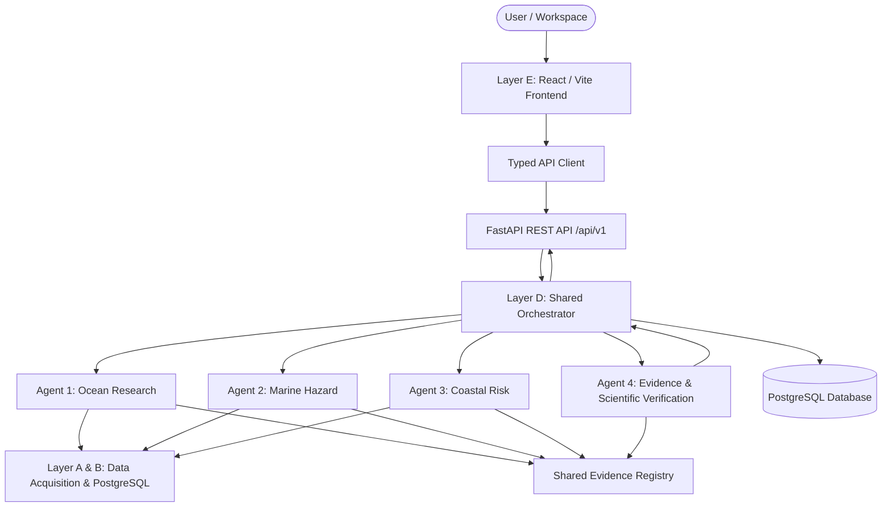

# ORCA Architecture Specification

## 1. System Overview

ORCA (Open-Source Marine and Coastal Intelligence Platform) is organized into five interconnected layers designed for transparency, scientific verifiability, and collaborative multi-agent execution.

---

## 2. The Five System Layers

### Layer A: Data Acquisition
- Connects to external data providers (Open-Meteo, NOAA IBTrACS, GDACS, Copernicus Marine, OSM Overpass, WorldPop).
- Ingests data through scheduled or on-demand pipelines.
- Preserves raw source timestamps, coordinate reference systems (CRS WGS84), and dataset version metadata.
- Handles rate-limiting, network retries, and schema normalization.

### Layer B: Shared Data & Evidence Layer (PostgreSQL)
- PostgreSQL functions as the single source of truth across all 3 roles.
- Standardized tables for:
  - Marine observations (SST, wave height, currents, chlorophyll).
  - Hazard events, tracks, and metadata.
  - Coastal features (boundaries, settlements, infrastructure).
  - Evidence records and provenance linkages.
  - Investigation state and real-time execution events.
- All stored timestamps are in UTC.
- All spatial coordinates are stored as WGS84 longitude/latitude.

### Layer C: Four Specialist Agents
Every agent implements the mandatory `BaseAgent` interface (`backend/app/agents/base.py`):
1. **Ocean Intelligence & Research Agent** (Person 1): Oceanographic observations, time-series trends, anomalies.
2. **Marine Hazard & Forecast Agent** (Person 2): Cyclones, storm tracks, GDACS alerts, marine forecast feeds.
3. **Coastal Impact & Risk Agent** (Person 3): Spatial intersections, coastal settlement vulnerability, deterministic population exposure.
4. **Evidence & Scientific Verification Agent** (Person 3): Scientific validity verification, cross-referencing claims with evidence records, calculation reproduction.

### Layer D: Orchestrator & Verification
- Receives investigation requests from `/api/v1/investigations`.
- Formulates a task-specific execution plan (selecting only relevant agents).
- Dispatches execution tasks to agents.
- Streams or records genuine execution events (`investigation_started`, `agent_started`, `tool_completed`, `evidence_added`, `verification_passed`, `investigation_completed`).
- Calls Agent 4 for scientific verification.
- Aggregates findings, limitations, and evidence into a unified response.

### Layer E: Frontend Workspaces
Single React application serving five specialized workspaces:
1. **Fisherman Workspace**: Local marine conditions, safety warnings, wave/wind forecast.
2. **Marine Monitoring Workspace**: Sea surface temperature analysis, chlorophyll trends, environmental comparisons.
3. **Protected Areas Workspace**: Marine sanctuary monitoring, habitat threats, boundary overlaps.
4. **Coastal Authority Workspace**: Coastal infrastructure exposure, settlement proximity, vulnerability assessments.
5. **Disaster Management Workspace**: Cyclone tracking, forecast cones, emergency planning, replay of historical events.
